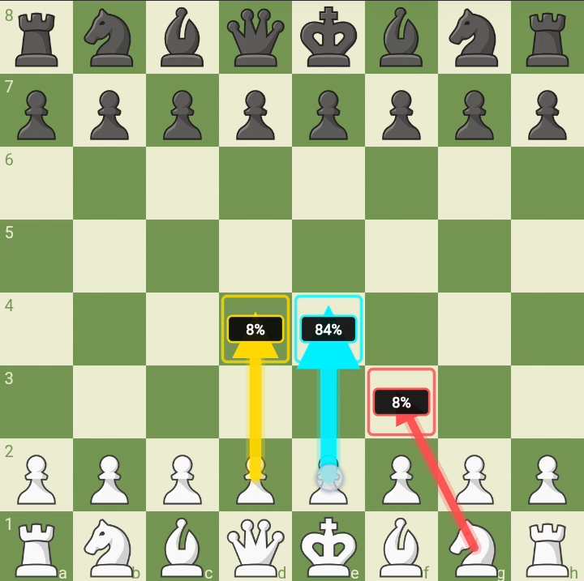

# Mate.ai — Landing Page

Landing page untuk **Mate.ai**, sebuah proyek ekstensi Chrome eksperimental yang menjalankan Stockfish 18 (WASM) sebagai alat analisis. Repo ini hanya berisi halaman web statis (HTML, CSS, JavaScript) untuk memperkenalkan proyek tersebut.

Live demo: https://mateaiofficial.vercel.app

---

## Daftar isi

- [Fitur halaman](#fitur-halaman)
- [Struktur proyek](#struktur-proyek)
- [Menjalankan secara lokal](#menjalankan-secara-lokal)
- [Deploy ke Vercel](#deploy-ke-vercel)
- [Menambahkan atau mengganti gambar](#menambahkan-atau-mengganti-gambar)
- [Menambahkan bahasa baru](#menambahkan-bahasa-baru)
- [Kustomisasi desain](#kustomisasi-desain)
- [Catatan fair play](#catatan-fair-play)
- [Lisensi dan kredit](#lisensi-dan-kredit)

---

## Fitur halaman

- **Dua bahasa:** Inggris (EN) dan Indonesia (ID), bisa diganti lewat tombol di navbar. Pilihan bahasa disimpan di `localStorage`.
- **Tab instalasi:** panduan terpisah untuk Desktop, Mobile (Android via Lemur Browser), dan cara pakai.
- **Animasi scroll:** elemen muncul bertahap dari bawah saat di-scroll. Animasi otomatis dimatikan untuk pengguna yang mengaktifkan *reduce motion*.
- **Responsif:** tata letak menyesuaikan layar desktop, tablet, dan HP.
- **Tanpa framework:** HTML, CSS, dan JavaScript biasa, tanpa build step.

---

## Struktur proyek

```

mate-ai/
├── index.html        # Struktur halaman dan teks (dengan atribut data-i18n)
├── styles.css        # Seluruh styling, termasuk animasi scroll
├── app.js            # Terjemahan, tab instalasi, dan animasi scroll
├── vercel.json       # Konfigurasi deployment Vercel
├── assets/
│   ├── logo.jpg      # Logo squircle di atas kartu papan
│   ├── board-demo.webp  # Screenshot papan untuk hero
│   └── fischer.png   # Gambar kartu bawah (transparan disarankan)
├── DESIGN.md         # Panduan arah desain
└── README.md
```

---

## Menjalankan secara lokal

Tidak perlu install apa pun. Cukup buka `index.html` di browser, atau jalankan server statis:

```bash
# Python 3
python -m http.server 8000

# Node.js (npx)
npx serve .
```

Lalu buka `http://localhost:8000`.

---

## Deploy ke Vercel

1. Push repo ke GitHub.
2. Di dashboard Vercel, pilih **Add New → Project**, lalu impor repo ini.
3. Biarkan *Framework Preset* di **Other** dan *Build Command* kosong.
4. Klik **Deploy**. Setiap push ke branch `main` akan otomatis redeploy.

Pastikan semua file di folder `assets/` ikut ter-commit. Nama file dan huruf besar-kecilnya harus sama persis, karena server Vercel membedakan huruf besar dan kecil.

---

## Menambahkan atau mengganti gambar

Path gambar di `index.html` bersifat relatif. Contoh:

```html

```

Jika mengganti gambar, pakai nama file yang sama, atau ubah atribut `src` di `index.html`. Gambar berformat `.webp` atau `.png` dengan latar transparan paling cocok untuk kartu gelap.

---

## Menambahkan bahasa baru

Terjemahan ada di objek `dict` di `app.js`:

1. Tambahkan kode bahasa baru, misalnya `ms` untuk Melayu, dengan semua key yang sama seperti `en`.
2. Tambahkan tombol di `index.html`:
   ```html
   <button type="button" class="lang-btn" data-lang="ms" aria-pressed="false">MS</button>
   ```
3. Jika teks berisi HTML (seperti `<em>` atau `<code>`), gunakan atribut `data-i18n-html`.

---

## Kustomisasi desain

- **Warna:** ubah variabel di `:root` pada `styles.css`, misalnya `--indigo` dan `--wash`.
- **Font:** font utama diatur di `--font` dan `--mono`. Font dimuat dari Google Fonts di `<head>` di `index.html`.
- **Animasi:** durasi dan jarak geser diatur di blok `SCROLL REVEAL` pada `styles.css`.
- **Arah desain lengkap:** lihat `DESIGN.md`.

---

## Catatan fair play

Mate.ai adalah alat untuk belajar dan menganalisis posisi catur. Engine catur tidak boleh dipakai saat bermain di permainan rated, termasuk di Chess.com. Penggunaan seperti itu melanggar aturan fair play platform dan merugikan lawan. Repo ini tidak menyediakan kode ekstensi itu sendiri.

---

## Lisensi dan kredit

- Engine: [Stockfish 18](https://stockfishchess.org/) (WASM), lisensi GPL-3.0.
- Font: [Inter](https://rsms.me/inter/) dan [JetBrains Mono](https://www.jetbrains.com/lp/mono/), lisensi SIL OFL.
- Dibuat oleh **BagasValzz**.